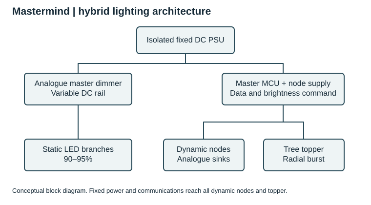

# Mastermind

The premium system: a predominantly static warm white tree with sparse individually addressable analogue current controlled LEDs. A central scheduler coordinates rare travelling comets and topper bursts while local nodes can generate autonomous dips.

- 90–95% passive LEDs on a regulated variable DC rail.
- Dynamic nodes on a suitable fixed supply with analogue current setpoints scaled by master brightness.
- Physical brightness, activity and magic controls; persistent settings.
- Low voltage keyed expansion connector for a topper (power, return, data; exact interface TBD).
- No compulsory app or cloud, no continuous LED PWM.
- Calibrate normal current to match passive emitters; reserve current headroom for bright twinkles.

See [driver concept](Analogue-Driver.svg) and [communications and topper](Communications.md). Status: untested architecture.
