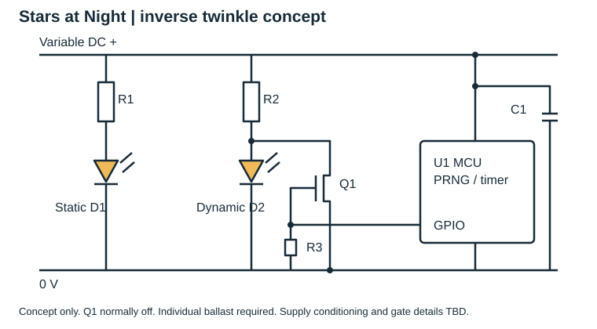

# The Stars at Night

A two wire, analogue dimmable Christmas light string with identical warm white emitters. Approximately 95–98% are passive, continuously illuminated; the remainder occasionally dip or disappear independently. No central animation controller, no multiplexing or continuous PWM. Target: 500 LEDs with 10–25 active modules; start with 100 and 2–5 modules.

The master regulated DC voltage controls resting brightness through individual branch ballast. A normally off shunt MOSFET steals current from selected LEDs. With Q1 off, static and dynamic branches are identical except for controller supply loading. Gradual dips require controlled gate voltage or an analogue current sink; binary GPIO alone only gives abrupt dips. No upward sparkle above the resting brightness is possible with this topology.

- [Circuit and BOM](Circuit-Design.md)
- [MCU and firmware](Firmware-Concept.md)

Status: concept, not yet bench tested.
